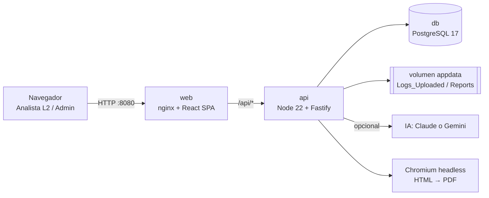
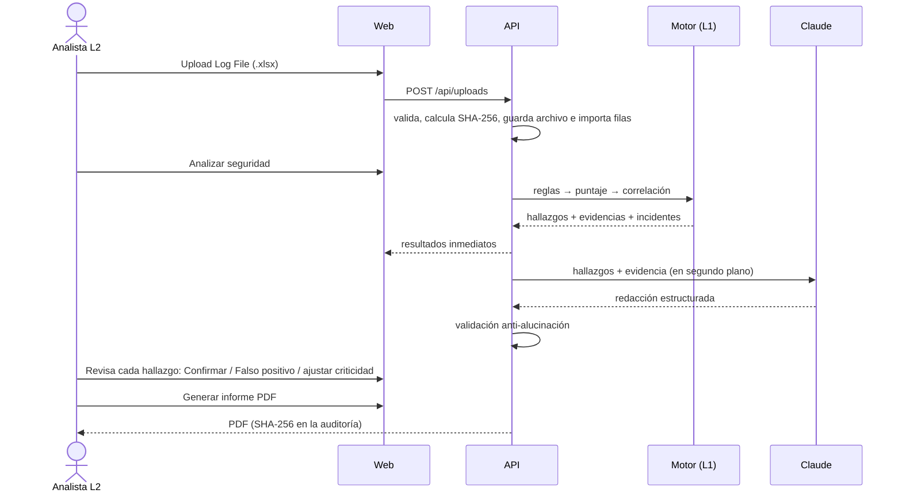
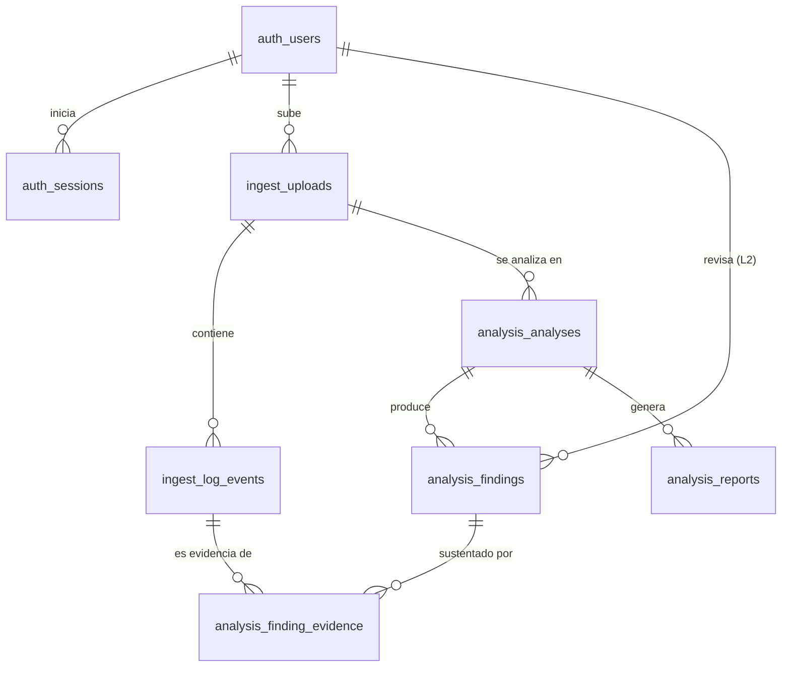

# SOC L2 Analyzer

Plataforma web para el **análisis de logs de seguridad a nivel SOC 2**. Carga un export del SIEM en Excel (`.xlsx`), detecta y correlaciona actividad sospechosa mapeada a **MITRE ATT&CK**, clasifica el riesgo (Crítico / Alto / Medio / Bajo) con justificación, permite que el **analista L2 valide cada hallazgo** y genera un **informe técnico en PDF** (resumido o completo) con redacción asistida por IA (Claude o Gemini).

> **Modelo operativo:** el sistema hace de **analista L1**: detecta, puntúa, correlaciona y redacta un borrador. La persona que usa la plataforma es el **analista L2**: confirma o descarta cada hallazgo, ajusta la criticidad con justificación y emite el informe final.

---

## Índice

1. [Funcionalidades](#1-funcionalidades)
2. [Arquitectura y tecnologías](#2-arquitectura-y-tecnologías)
3. [Puesta en marcha (Docker)](#3-puesta-en-marcha-docker)
4. [Variables de entorno (.env)](#4-variables-de-entorno-env)
5. [Roles y permisos](#5-roles-y-permisos)
6. [Flujo de trabajo](#6-flujo-de-trabajo)
7. [Motor de detección y MITRE ATT&CK](#7-motor-de-detección-y-mitre-attck)
8. [IA integrada y rigor analítico](#8-ia-integrada-y-rigor-analítico)
9. [Base de datos y trazabilidad](#9-base-de-datos-y-trazabilidad)
10. [Estructura del proyecto](#10-estructura-del-proyecto)
11. [Desarrollo local (sin Docker)](#11-desarrollo-local-sin-docker)
12. [Guía de mantenimiento](#12-guía-de-mantenimiento)
13. [Pruebas](#13-pruebas)
14. [Trabajo con Git](#14-trabajo-con-git)
15. [API REST](#15-api-rest)
16. [Seguridad de la plataforma](#16-seguridad-de-la-plataforma)
17. [Solución de problemas](#17-solución-de-problemas)
18. [Hoja de ruta / mejoras sugeridas](#18-hoja-de-ruta--mejoras-sugeridas)

---

## 1. Funcionalidades

| # | Requisito del curso | Cómo se cumple |
|---|---|---|
| 01 | **Carga de archivos**: importar y visualizar el Excel | Botón *Upload Log File* (arrastrar y soltar), validación de formato, calendario por fecha y *datagrid* paginado con búsqueda y filtros |
| 02 | **Análisis de seguridad**: identificar y correlacionar eventos | 15 reglas deterministas + correlación en incidentes por entidades (IP, usuario, equipo) y proximidad temporal |
| 03 | **Dashboard**: estadísticas y gráficos interactivos | Línea de tiempo, criticidad, tácticas ATT&CK, hosts, IPs, Event_ID, matriz MITRE e incidentes (ECharts) |
| 04 | **Clasificación de riesgos** con justificación | Puntaje 0-100 = base de la técnica + factores de contexto, cada uno explicado; ajuste manual del L2 con nota obligatoria |
| 05 | **Informe técnico** estructurado | Resumen ejecutivo, hallazgos, explicación técnica, evidencias (Log_ID), criticidad y justificación, impacto, plan de acción (investigar/contener/remediar) y recomendaciones |
| 06 | **Exportación PDF** | PDF generado con Chromium, guardado por usuario/fecha, con SHA-256 registrado y descarga desde la web |
| + | Interfaz moderna | React + Tailwind, tema oscuro estilo SOC |
| + | IA integrada | Claude **o Gemini (gratis)** redacta explicaciones, impacto, triaje L1 y resumen ejecutivo; **cada texto se valida contra la evidencia** |
| + | Sin Sentinel | No requiere Microsoft Sentinel ni ningún SIEM: trabaja con el export en Excel |
| + | Rigor analítico | Ninguna conclusión sin evidencia: cada hallazgo enlaza los eventos exactos (Log_ID) que lo sustentan |
| + | Login y trazabilidad | Usuarios con roles, sesiones revocables y bitácora de auditoría inmutable en PostgreSQL |

---

## 2. Arquitectura y tecnologías



| Capa | Tecnología | Motivo |
|---|---|---|
| Monorepo | **Yarn 1 workspaces** (`apps/api`, `apps/web`, `packages/shared`) | Un solo repositorio y tipos compartidos entre front y back |
| Lenguaje | **TypeScript** en todo el proyecto | Un solo lenguaje, errores detectados al compilar |
| Backend | **Fastify 5**, **Zod**, **Drizzle ORM**, `pg` | Rápido, moderno y con validación y SQL tipados |
| Seguridad | `@node-rs/argon2`, `@fastify/jwt` (cookie httpOnly), `@fastify/helmet`, `@fastify/rate-limit` | Buenas prácticas OWASP |
| Excel | Lector propio sobre `fflate` + `fast-xml-parser` | Compatible con el export .NET del curso y sin las CVE de SheetJS 0.18 (ver nota en `xlsx-reader.ts`) |
| PDF | `puppeteer-core` + Chromium del sistema | El PDF replica fielmente el diseño HTML |
| IA | `@anthropic-ai/sdk` (tool use) o Gemini REST (salida JSON con esquema) | Salida estructurada y validable; proveedor intercambiable desde el `.env` |
| Frontend | **React 19**, **Vite 7**, **Tailwind CSS 4**, TanStack Query/Table, ECharts, React Router 7, react-day-picker | SPA moderna y rápida |
| Build | `tsup` (API), `vite` (web), `vitest` (pruebas) | Igual que el `package.json` de referencia |
| Infraestructura | **Docker Compose** (db, api, web) | `docker compose build && docker compose up -d` |

---

## 3. Puesta en marcha (Docker)

**Requisitos:** Docker Desktop (Windows/macOS) o Docker Engine + Compose v2 (Linux).

```bash
# 1. Clonar y entrar
git clone <url-del-repo> soc-l2-analyzer
cd soc-l2-analyzer

# 2. Crear el archivo de entorno y editar los valores marcados con (!)
cp .env.example .env          # en PowerShell: Copy-Item .env.example .env

# 3. Construir e iniciar
docker compose build
docker compose up -d

# 4. Abrir
#    http://localhost:8080
```

- **Primer ingreso:** usuario y contraseña de `ADMIN_USERNAME` / `ADMIN_PASSWORD` del `.env`. El sistema exige cambiar la contraseña la primera vez.
- Como **admin**, crea al menos un usuario con rol **Analista SOC L2** (menú *Usuarios*). El analista es quien sube logs, analiza y emite informes.
- Para probar rápido usa el archivo `samples/SOC_L2_Logs_Ampliados_Multiples_Incidentes.xlsx`.

Comandos útiles:

```bash
docker compose ps                 # estado de los contenedores
docker compose logs -f api        # logs del backend
docker compose down               # detener (los datos se conservan en volúmenes)
docker compose down -v            # detener y BORRAR datos (BD, logs subidos, PDFs)
docker compose build api && docker compose up -d api   # reconstruir solo la API
```

**Dónde quedan los archivos:** en el volumen Docker `appdata`, dentro del contenedor en `/data`:

```
/data/Logs_Uploaded/<usuario>/<yyyy_mm_dd>/<archivo>_<hh-mm-ss>.xlsx
/data/Reports/<usuario>/<yyyy_mm_dd>/Informe_SOC_<archivo>_<hh-mm-ss>.pdf
```

Para copiarlos al host: `docker cp soc-api:/data ./respaldo-data`.

---

## 4. Variables de entorno (.env)

El archivo `.env` **no se sube a git** (`.gitignore`). La plantilla versionada es `.env.example`. La API valida todas las variables al arrancar (`apps/api/src/config/env.ts`) y no inicia si falta una obligatoria.

| Variable | Obligatoria | Descripción |
|---|---|---|
| `WEB_PORT` | | Puerto publicado de la web (por defecto 8080) |
| `APP_TIMEZONE` | | Zona horaria para mostrar fechas y nombrar carpetas (`America/Panama`) |
| `ORG_NAME` | | Nombre de la organización en el informe |
| `MAX_UPLOAD_MB` | | Tamaño máximo del Excel (debe ser ≤ `client_max_body_size` de `nginx.conf`) |
| `POSTGRES_USER` / `POSTGRES_PASSWORD` / `POSTGRES_DB` | ✔ | Credenciales de PostgreSQL |
| `DB_PORT` | | Puerto local (solo en 127.0.0.1) para DBeaver/pgAdmin |
| `DATABASE_URL`, `DATA_DIR` | | Solo para desarrollo local sin Docker (Compose los sobrescribe) |
| `JWT_SECRET` | ✔ | Secreto de firma de sesiones (≥ 32 caracteres) |
| `SESSION_HOURS` | | Duración de la sesión |
| `COOKIE_SECURE` | | `true` si se sirve por HTTPS |
| `ADMIN_USERNAME` / `ADMIN_PASSWORD` / `ADMIN_FULL_NAME` | ✔ | Admin inicial (solo se crea si no hay usuarios) |
| `AI_PROVIDER` | | `auto` (por defecto), `anthropic`, `gemini` o `none` |
| `GEMINI_API_KEY` | | Clave **gratuita** de Google AI Studio (https://aistudio.google.com/apikey) |
| `GEMINI_MODEL` | | Modelo de Gemini (por defecto `gemini-flash-latest`) |
| `ANTHROPIC_API_KEY` | | Clave de Claude (prepago en console.anthropic.com, aparte de la suscripción de claude.ai) |
| `ANTHROPIC_MODEL` | | Modelo de Claude (por defecto `claude-sonnet-5-5`) |
| `AI_MAX_TOKENS` | | Límite de tokens de salida para la redacción |
| `LOG_LEVEL` | | Nivel de log de la API |

> ⚠️ No uses `#` dentro de los valores sin comillas: se interpreta como comentario.

---

## 5. Roles y permisos

Definidos en `packages/shared/src/constants.ts` (`ROLES`, `ROLE_PERMISSIONS`). El backend verifica el permiso en **cada endpoint** (`requirePerm`) y la web solo oculta lo que el usuario no puede usar.

| Permiso | Administrador | Analista SOC L2 |
|---|:---:|:---:|
| `users:manage`: crear, editar, desactivar usuarios y restablecer claves | ✔ | |
| `audit:read`: ver la bitácora de auditoría | ✔ | |
| `uploads:read`: ver cargas y eventos | ✔ (todas, supervisión) | ✔ (las propias) |
| `uploads:create`: subir Excel | | ✔ |
| `analysis:run`: ejecutar análisis / IA | | ✔ |
| `findings:review`: confirmar, descartar, ajustar criticidad | | ✔ |
| `reports:generate`: generar PDF | | ✔ |
| `reports:read`: descargar PDF | ✔ | ✔ |

**Separación de funciones:** el admin administra la plataforma pero no altera análisis; el analista opera pero no gestiona cuentas ni ve la auditoría.

Controles de cuenta: contraseñas Argon2id con política de complejidad, cambio obligatorio en el primer ingreso, bloqueo de 15 min tras 5 intentos fallidos, *rate limit* en el login, sesiones revocables (al desactivar un usuario o cambiar su clave se cierran sus sesiones) y nadie puede quitarse a sí mismo el rol de admin ni dejar el sistema sin administradores.

> Para agregar un rol (p. ej. `viewer`) ver [§12.4](#124-agregar-un-rol).

---

## 6. Flujo de trabajo



1. **Logs y análisis** → *Upload Log File*. El calendario marca los días con cargas; si el día no tiene archivos aparece *"No Data Available for this Date"*.
2. Al abrir un archivo se ve el **datagrid** completo (búsqueda, filtros por host, Event_ID, fuente y severidad). **Back** vuelve al calendario.
3. **Analizar seguridad** ejecuta el motor (segundos). La IA, si está activa, redacta en segundo plano y la pantalla se actualiza sola.
4. Pestañas del análisis: **Dashboard**, **Hallazgos** (revisión L2), **Incidentes** (cadenas correlacionadas), **Matriz MITRE**, **Eventos** (con filtro *Solo evidencias*) e **Informe técnico**.
5. **Informe técnico** → *Generar informe PDF* (opcionalmente solo con hallazgos confirmados). Los falsos positivos se excluyen siempre.

---

## 7. Motor de detección y MITRE ATT&CK

Código: `apps/api/src/modules/analysis/engine/`

| Archivo | Responsabilidad |
|---|---|
| `rules.ts` | Reglas de detección y umbrales (`THRESHOLDS`) |
| `helpers.ts` | Utilidades: IP pública/privada, tipos de logon, ráfagas temporales... |
| `index.ts` | Normalización, puntuación, correlación, calidad de datos y estadísticas |
| `narrative.ts` | Resumen ejecutivo y recomendaciones deterministas (respaldo sin IA) |
| `packages/shared/src/mitre.ts` | Catálogo de técnicas y tácticas ATT&CK |

### Reglas incluidas

| Regla | Detecta | MITRE |
|---|---|---|
| `CRED-SPRAY` / `CRED-BRUTEFORCE` | Muchos 4625 desde una IP contra varias cuentas | T1110.003 / T1110.001 |
| `CRED-COMPROMISE` | Logon exitoso desde la IP atacante (+4672) | T1078, T1133 |
| `CRED-GUESS-SUCCESS` / `CRED-RDP-BRUTEFORCE` | Fallos seguidos de éxito (mismo usuario e IP), RDP tipo 10 | T1110.001, T1078, T1021.001, T1133 |
| `WEB-SHELL` | Script en carpeta de subidas con parámetro de comando; procesos del pool IIS | T1190, T1505.003, T1059.003 |
| `WEB-SCAN` | Sondeo de rutas admin/login/export | T1595.003, T1110.001 |
| `PERSIST-SCHEDULED-TASK` / `PERSIST-SERVICE` | 4698 / 7045, rutas sospechosas, nombres que imitan Windows | T1053.005, T1543.003, T1036.004 |
| `IMPACT-INHIBIT-RECOVERY` | `vssadmin delete shadows`, `wbadmin delete`... | T1490 |
| `EXEC-ENCODED-PS` | PowerShell `-EncodedCommand` | T1059.001, T1027.010 |
| `LAT-SMB` | Logon de red tipo 3 entre servidores + acceso a shares | T1021.002, T1078, T1039 |
| `COLL-MASS-ACCESS` | ≥10 archivos leídos en minutos | T1039 |
| `COLL-ARCHIVE` | 7z/rar/tar/Compress-Archive (staging) | T1560.001, T1074.001 |
| `EXFIL-VOLUME` | Gran volumen `bytes_out` a destino externo | T1048.002, T1030 |
| `C2-OUTBOUND` | Intérprete (powershell/cmd...) conectando a IP pública | T1071.001, T1041 |
| `DISC-RECON` | whoami, net view, Get-LocalGroupMember, Get-SmbShare | T1033, T1069.001, T1135 |
| `COLL-SENSITIVE-SHARE` / `ACCESS-EXTERNAL-LOGON` | Residuales: shares sensibles, logons desde IP pública | T1039 / T1078, T1133 |

### Clasificación de riesgo

`puntaje = base de la regla + factores de la regla + contexto` (máximo 100):

- **Contexto genérico:** IP externa (+10), cuenta privilegiada (+10), activo crítico DC/FS/DB/SRV (+5), parte de un incidente con ≥3 tácticas ATT&CK (+5).
- **Escala:** Crítico ≥90 · Alto ≥70 · Medio ≥45 · Bajo <45 (`severityFromScore` en `shared/constants.ts`).
- Cada factor queda guardado y se muestra en la web y en el PDF como **justificación**. La columna `Severity` del SIEM **no se usa** para clasificar (en el archivo de ejemplo subestima eventos maliciosos) y esto se informa en *Calidad de datos*.

### Correlación

Dos hallazgos se agrupan en un **incidente** si comparten una entidad "actora" (IP externa, usuario o equipo de origen) y ocurren con menos de 60 min de diferencia. Los servidores de archivos accedidos no se usan como clave, porque los comparten muchos usuarios y unirían incidentes independientes. Cada incidente muestra su cadena de tácticas y el **criterio de correlación** aplicado.

### Calidad de datos

El motor reporta inconsistencias que afectan el análisis: mismo host con nombres distintos (`DC-01` / `DC01`), cuentas con nombres casi idénticos (`backupsvc` / `svc_backup`), Event_ID no numéricos, fechas inválidas y severidades de origen subestimadas.

### Resultado con el archivo de ejemplo

19 hallazgos en 6 incidentes: password spraying con compromiso de `mgarcia`; intrusión RDP en APP-SRV01 con PowerShell codificado, reconocimiento, movimiento lateral a FS-SRV01, compresión y conexión saliente; acceso masivo a Finanzas con borrado de shadow copies en WS-023; exfiltración de unos 242 MB desde WS-018; persistencia (tarea + servicio `WinUpdateHelper`) en APP-SRV01; y web shell en WEB-01.

---

## 8. IA integrada y rigor analítico

Código: `apps/api/src/modules/ai/`

1. La IA **no detecta**: recibe solo los hallazgos del motor y hasta 30 filas de evidencia por hallazgo.
2. Responde por *tool use* con un JSON estricto (`schema.ts`) validado con Zod: explicación técnica, impacto, **triaje L1** (probable verdadero/falso positivo) y resumen ejecutivo.
3. **Validación anti-alucinación** (`narrative.service.ts → checkText`):
   - los `Log_ID` citados deben pertenecer a la evidencia de **ese** hallazgo;
   - cualquier Log_ID, IP o técnica MITRE mencionada debe existir en el archivo o en el hallazgo;
   - si algo no cuadra, el texto se **descarta**, se conserva el texto del motor y el motivo queda registrado (`analyses.ai_rejected`), visible en la web y en el anexo del PDF.
4. Si no hay clave de IA o la IA falla, todo sigue funcionando con textos deterministas.

**Proveedores incluidos** (`ai/provider.ts`), elegidos con `AI_PROVIDER`:

| Proveedor | Costo | Cómo obtener la clave | Variables |
|---|---|---|---|
| **Gemini** (Google) | Plan gratuito con límites por minuto/día | https://aistudio.google.com/apikey → *Create API key* | `GEMINI_API_KEY`, `GEMINI_MODEL` |
| **Claude** (Anthropic) | Prepago por uso | https://console.anthropic.com → *API Keys* | `ANTHROPIC_API_KEY`, `ANTHROPIC_MODEL` |

> En el plan gratuito de Gemini, Google puede usar las solicitudes para mejorar sus productos: está bien para datos de práctica como los del curso, no para logs reales de una empresa.

Tras cambiar la clave: `docker compose up -d` y, para análisis ya hechos, *Informe técnico → Volver a redactar con IA*.

**Agregar otro proveedor** (OpenAI, Ollama...): implementa la interfaz `NarrativeProvider` y agrégalo en `getProvider()`.

---

## 9. Base de datos y trazabilidad

Esquema en `apps/api/src/db/schema.ts` (Drizzle). Todas las fechas de sistema se guardan en **UTC** (`timestamptz`) y se muestran en `APP_TIMEZONE`. La hora de los logs se guarda **tal cual viene**, sin asumir zona horaria.



| Esquema | Tablas | Contenido |
|---|---|---|
| `auth` | `users`, `sessions` | Cuentas (hash Argon2id, rol, bloqueo, último login) y cada sesión con IP, user-agent, expiración y revocación |
| `ingest` | `uploads`, `log_events` | Archivo (nombre original, ruta, **SHA-256**, filas) y cada evento con las 12 columnas del SIEM |
| `analysis` | `analyses`, `findings`, `finding_evidence`, `reports` | Resultado del motor, revisión L2 (quién, cuándo, notas, override), evidencias por Log_ID, PDFs con SHA-256 |
| `audit` | `audit_log` | Bitácora **inmutable** (un trigger impide UPDATE/DELETE): login (exitoso, fallido, bloqueado), accesos denegados, usuarios, cargas, análisis, revisiones (con valores antes/después), informes y descargas |

Vista de apoyo: `analysis.v_finding_trace` une hallazgo → revisor → análisis → archivo (SHA-256) → quien lo subió → cada evento de evidencia.

```sql
-- Ejemplo desde DBeaver (localhost:${DB_PORT})
SELECT title, effective_severity, status, reviewed_by, log_id, ts, hostname, source_ip
FROM analysis.v_finding_trace
WHERE original_name ILIKE '%SOC_L2%'
ORDER BY title, ts;
```

**Migraciones:** viven en `apps/api/drizzle/` y se aplican **automáticamente** al iniciar la API.

---

## 10. Estructura del proyecto

```
soc-l2-analyzer/
├── docker-compose.yml          # db + api + web
├── .env.example                # plantilla de variables (copiar a .env)
├── package.json                # workspaces y scripts globales
├── samples/                    # Excel de ejemplo del curso (lo usan las pruebas)
├── packages/shared/src/
│   ├── constants.ts            # roles, permisos, criticidades, columnas esperadas
│   ├── mitre.ts                # catálogo MITRE ATT&CK
│   └── types.ts                # DTOs compartidos API ↔ web
├── apps/api/
│   ├── Dockerfile
│   ├── drizzle/                # migraciones SQL versionadas
│   ├── test/                   # pruebas vitest (motor + validación IA)
│   └── src/
│       ├── index.ts            # arranque de Fastify, migraciones y seed
│       ├── config/env.ts       # validación de variables de entorno
│       ├── db/                 # schema, cliente, migrador, seed del admin
│       ├── lib/                # contraseñas, errores, rutas seguras, fechas
│       ├── plugins/auth.ts     # sesión por cookie + requirePerm()
│       └── modules/
│           ├── auth/           # login, logout, me, cambio de clave
│           ├── users/          # administración de usuarios
│           ├── audit/          # registro y consulta de auditoría
│           ├── uploads/        # carga, lector XLSX, eventos (datagrid)
│           ├── analysis/       # servicio + rutas + engine/ (reglas)
│           ├── ai/             # proveedor Claude, esquema y validación
│           └── reports/        # plantilla HTML del informe y PDF
└── apps/web/
    ├── Dockerfile, nginx.conf  # SPA + proxy /api
    └── src/
        ├── main.tsx            # rutas
        ├── api/                # cliente HTTP + hooks (TanStack Query)
        ├── lib/                # sesión/guardas, formato de fechas
        ├── components/         # UI, Chart, EventsGrid, Layout, analysis/*
        └── pages/              # Login, Dashboard, Uploads, Analysis, admin/*
```

---

## 11. Desarrollo local (sin Docker)

Requisitos: Node 22+, Yarn 1.22, PostgreSQL y Chrome/Chromium (para el PDF; define `CHROMIUM_PATH` si no está en la ruta por defecto).

```bash
yarn install
cp .env.example .env            # ajusta DATABASE_URL a tu PostgreSQL local
docker compose up -d db         # opcional: solo la base de datos en Docker
yarn dev:api                    # API en http://localhost:3000 (recarga automática)
yarn dev:web                    # Web en http://localhost:5173 (proxy /api → 3000)
```

Scripts globales: `yarn typecheck`, `yarn test`, `yarn build`, `yarn db:generate`.

---

## 12. Guía de mantenimiento

### 12.1 Agregar una regla de detección
1. Si usa técnicas nuevas, agrégalas a `packages/shared/src/mitre.ts`.
2. En `engine/rules.ts` crea un objeto `Rule` con `run(ctx)` que devuelva `RawFinding[]`: eventos de evidencia, técnicas, `baseScore`, textos y `actionPlan`. Usa `unclaimed()` y `claim()` para no duplicar eventos de otras reglas.
3. Agrégala a `RULES`: el orden importa, las específicas van antes que las genéricas.
4. Agrega un nombre corto en `RULE_SHORT` (`engine/index.ts`) y recomendaciones en `engine/narrative.ts` si corresponde.
5. Agrega una prueba en `apps/api/test/engine.test.ts` y ejecuta `yarn test`.

### 12.2 Ajustar umbrales o criticidad
- Umbrales de reglas: `THRESHOLDS` en `rules.ts`.
- Factores de contexto: `score()` en `engine/index.ts`.
- Escala: `severityFromScore` y `SEVERITY_SCALE_TEXT` en `shared/constants.ts`.

### 12.3 Cambiar la base de datos
1. Edita `apps/api/src/db/schema.ts`.
2. `yarn db:generate` crea `apps/api/drizzle/NNNN_*.sql`. Revísala y súbela a git.
3. Para SQL a mano (triggers, vistas): `cd apps/api && npx drizzle-kit generate --custom --name mi_cambio`.
4. Al reiniciar la API la migración se aplica sola. **Nunca edites una migración ya aplicada**: crea una nueva.

### 12.4 Agregar un rol
1. `ROLES`, `ROLE_LABELS` y `ROLE_PERMISSIONS` en `shared/constants.ts`.
2. `roleEnum` en `db/schema.ts` y luego `yarn db:generate`.
3. Si necesita nuevas capacidades, agrega el permiso a `PERMISSIONS` y protégelo con `requirePerm('nuevo:permiso')`.

### 12.5 Nuevas columnas o formatos de log
- Columnas esperadas/obligatorias: `EXPECTED_COLUMNS` / `REQUIRED_COLUMNS` (`shared/constants.ts`). El lector ignora mayúsculas, espacios y guiones bajos.
- Mapeo de columnas: `parseWorkbook()` en `uploads/excel.ts`.
- Formatos de fecha aceptados: `parseTimestamp()` en el mismo archivo.

### 12.6 Modificar el informe PDF
- Plantilla: `reports/report.template.ts` (HTML + CSS con gráficos SVG en línea).
- Para iterar el diseño sin generar PDF: pestaña *Informe técnico* → **Vista previa HTML**.

### 12.7 Actualizar dependencias
```bash
yarn outdated
yarn workspace @soc/api upgrade-interactive --latest   # o editar package.json
yarn install && yarn typecheck && yarn test && yarn build
```
Sube siempre el `yarn.lock`: los Dockerfile usan `--frozen-lockfile`.

### 12.8 Respaldo y restauración
```bash
# Base de datos
docker compose exec db pg_dump -U $POSTGRES_USER $POSTGRES_DB > respaldo.sql
docker compose exec -T db psql -U $POSTGRES_USER $POSTGRES_DB < respaldo.sql
# Archivos (Excel y PDF)
docker cp soc-api:/data ./respaldo-data
```

---

## 13. Pruebas

```bash
yarn test
```

- `engine.test.ts`: lee el Excel de ejemplo (715 filas) y verifica cada detección esperada, que no se correlacionen incidentes independientes, que toda evidencia exista y que cada hallazgo tenga técnica MITRE.
- `ai-validation.test.ts`: verifica que la validación rechace Log_ID, IP y técnicas inventadas.

---

## 14. Trabajo con Git

```bash
git init
git add .
git commit -m "feat: versión inicial SOC L2 Analyzer"
git branch -M main
git remote add origin <url>
git push -u origin main
```

- **Nunca** se suben `.env`, `node_modules/`, `dist/` ni `data/` (ver `.gitignore`).
- `.gitattributes` fuerza finales de línea LF: evita errores en contenedores Linux al clonar en Windows.
- Sugerencia de ramas: `main` (estable), `feature/<nombre>`, `fix/<nombre>`.
- Mensajes con *Conventional Commits*: `feat:`, `fix:`, `docs:`, `refactor:`, `test:`, `chore:`.
- Antes de cada commit: `yarn typecheck && yarn test`.

---

## 15. API REST

Todas las rutas usan el prefijo `/api` y requieren sesión (cookie `soc_session`), salvo `login` y `health`. Los errores responden `{ "error": "mensaje", "details"?: [...] }`.

| Método | Ruta | Permiso | Descripción |
|---|---|---|---|
| GET | `/health` | — | Estado de la API y la BD |
| POST | `/auth/login` | — | Inicia sesión `{username, password}` |
| POST | `/auth/logout` | sesión | Cierra la sesión |
| GET | `/auth/me` | sesión | Usuario actual, permisos, IA y zona horaria |
| POST | `/auth/change-password` | sesión | Cambia la contraseña |
| GET/POST | `/users` | users:manage | Lista / crea usuarios |
| PATCH | `/users/:id` | users:manage | Cambia rol, nombre o estado |
| POST | `/users/:id/reset-password` | users:manage | Restablece la contraseña |
| GET | `/audit`, `/audit/actions` | audit:read | Bitácora paginada y filtros |
| POST | `/uploads` | uploads:create | Sube un `.xlsx` (multipart `file`) |
| GET | `/uploads?date=YYYY-MM-DD` | uploads:read | Cargas de un día |
| GET | `/uploads/days?month=YYYY-MM` | uploads:read | Días con cargas (calendario) |
| GET | `/uploads/recent`, `/uploads/:id` | uploads:read | Recientes / detalle |
| GET | `/uploads/:id/events` | uploads:read | Eventos paginados (`q`, `hostname`, `eventId`, `logSource`, `severitySrc`, `analysisId`, `findingId`) |
| GET | `/uploads/:id/facets`, `/uploads/:id/download` | uploads:read | Valores para filtros / archivo original |
| POST | `/uploads/:id/analyses` | analysis:run | Ejecuta el análisis |
| GET | `/analyses?uploadId=`, `/analyses/:id` | uploads:read | Lista / detalle completo |
| POST | `/analyses/:id/ai` | analysis:run | Reintenta la redacción con IA |
| PATCH | `/findings/:id` | findings:review | `{status, severityOverride, analystNotes}` |
| GET/POST | `/analyses/:id/reports` | reports:read / reports:generate | Lista / genera PDF `{includePending}` |
| GET | `/reports/:id/download[?inline=1]` | reports:read | Descarga el PDF |
| GET | `/analyses/:id/report-preview` | reports:read | Vista previa HTML del informe |
| GET | `/dashboard` | uploads:read | Totales para el inicio |

---

## 16. Seguridad de la plataforma

- Contraseñas con Argon2id (parámetros OWASP); sesiones en cookie `httpOnly` + `SameSite=Strict`, validadas contra la BD en cada petición.
- Validación de entrada con Zod en todos los endpoints; consultas parametrizadas (Drizzle).
- Subida: solo `.xlsx`, verificación de firma ZIP, límite de tamaño, protección anti zip-bomb, nombres saneados y rutas confinadas a `DATA_DIR` (anti *path traversal*).
- Chromium sin acceso a red al generar el PDF; el HTML del informe escapa todos los datos del log (contenido potencialmente malicioso).
- Cabeceras de seguridad (helmet + nginx); la base de datos solo se publica en `127.0.0.1`.
- Auditoría inmutable a nivel de base de datos.
- **Para producción:** HTTPS (proxy inverso con TLS) y `COOKIE_SECURE=true`, secretos robustos, quitar el puerto de la BD en `docker-compose.yml` y respaldos periódicos.

---

## 17. Solución de problemas

| Síntoma | Causa / solución |
|---|---|
| `❌ Variables de entorno inválidas` en `docker compose logs api` | Falta o es inválida una variable del `.env` (el mensaje indica cuál) |
| La web muestra error 502 | La API aún está iniciando o falló: `docker compose logs api` |
| No puedo entrar con el admin | El admin se crea solo si la BD no tiene usuarios. Si cambiaste `ADMIN_PASSWORD` después del primer arranque, no se actualiza: usa `docker compose down -v` (borra datos) o restablece la clave desde otro admin |
| "Cuenta bloqueada temporalmente" | 5 intentos fallidos: espera 15 min o pide a un admin que restablezca la clave |
| El PDF falla | Revisa los logs de la API; la imagen incluye Chromium. Fuera de Docker define `CHROMIUM_PATH` |
| La IA queda en "falló" | Clave inválida, sin saldo/cuota o modelo incorrecto (`GEMINI_MODEL` / `ANTHROPIC_MODEL`). Con Gemini gratis, "límite alcanzado" significa esperar unos minutos o probar `gemini-flash-lite-latest`. El análisis sigue siendo válido con textos del motor |
| "Faltan columnas obligatorias" | El Excel debe tener al menos `Log_ID, Timestamp, Hostname, Event_ID, Event_Description` |
| Puerto 8080 o 5432 ocupado | Cambia `WEB_PORT` o `DB_PORT` en `.env` |

---

## 18. Hoja de ruta / mejoras sugeridas

- **Rol `viewer` / Gerente SOC** (solo lectura de análisis e informes) y **flujo de aprobación** del informe (L2 redacta → líder aprueba → se firma).
- **Enriquecimiento de IoC**: reputación de IPs (AbuseIPDB, VirusTotal, GreyNoise) y GeoIP en los hallazgos.
- **Más formatos de entrada**: CSV, JSON, EVTX y Sysmon; mapeo de columnas configurable desde la web.
- **Reglas Sigma**: importar reglas Sigma y ejecutarlas sobre los eventos.
- **Chat con la IA sobre el análisis** ("¿qué hizo CORP\admin después de las 09:10?"), con respuestas citando Log_ID.
- **Línea de tiempo interactiva** del incidente y **grafo de entidades** (usuario ↔ host ↔ IP).
- **Gestión de casos**: asignación, estados (abierto, en investigación, cerrado), SLA y comentarios.
- **Exportar** IoC en STIX/CSV y el informe a DOCX; firma digital del PDF.
- **Notificaciones** (correo, Teams, Slack) para hallazgos críticos.
- **MFA (TOTP)** y SSO (OIDC / Entra ID) para el login.
- **Colas de trabajo** (BullMQ + Redis) para archivos grandes y análisis en segundo plano.
- **CI/CD** con GitHub Actions: typecheck, pruebas, build de imágenes y escaneo (Trivy, `npm audit`).
- **Observabilidad**: métricas Prometheus y tablero Grafana de la plataforma.
- **Retención de datos** configurable y depuración automática de archivos antiguos.
